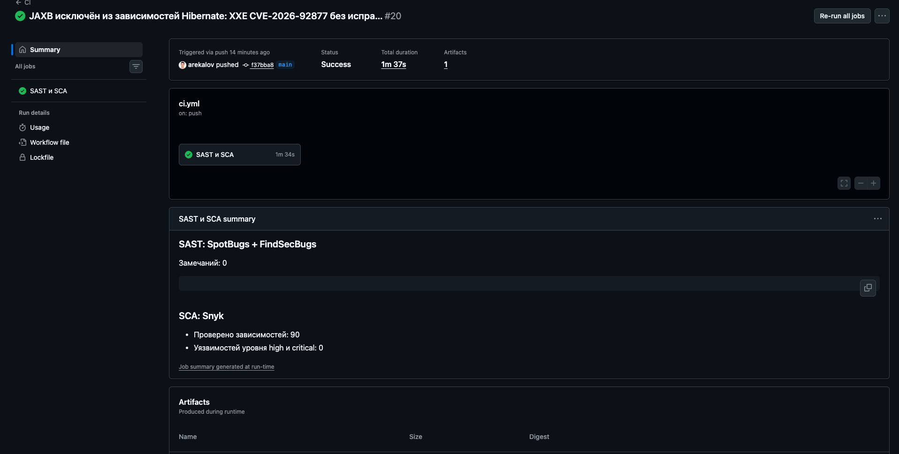
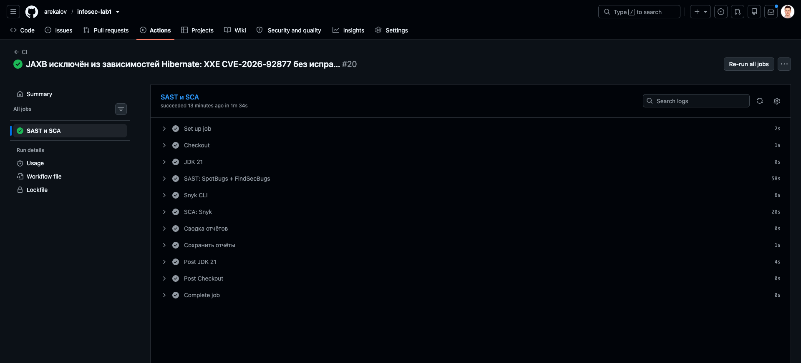
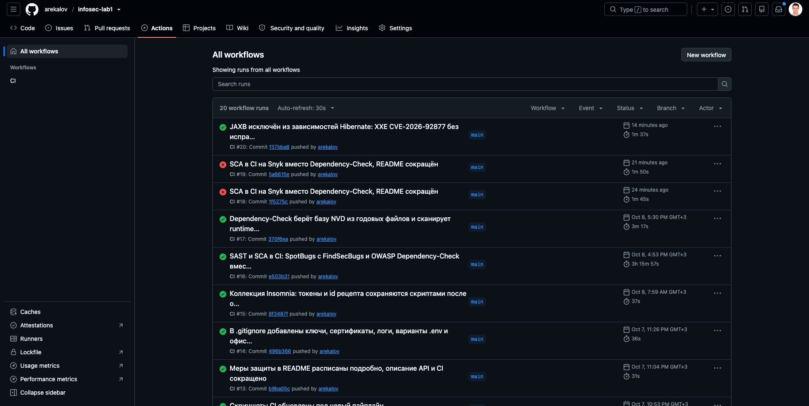

# Recipe API

REST API для хранения кулинарных рецептов на Kotlin и Spring Boot. Каждый пользователь работает
только со своими рецептами, доступ к ним — по JWT-токену, выданному после входа.

## API

Открыты только `/auth/register` и `/auth/login`, остальные запросы требуют заголовок
`Authorization: Bearer <token>`.

| Метод | Путь | Назначение |
|---|---|---|
| `POST` | `/auth/register` | Регистрация: `{username, password}` |
| `POST` | `/auth/login` | Вход, выдача JWT |
| `GET` | `/api/data` | Список своих рецептов, поиск `?q=` |
| `POST` | `/api/recipes` | Создать рецепт |
| `GET`, `PUT`, `DELETE` | `/api/recipes/{id}` | Прочитать, изменить, удалить свой рецепт |

## Меры защиты

### SQL-инъекции

Все запросы к базе идут через Spring Data JPA с параметрами, SQL из строк нигде не склеивается.
Поиск по названию написан на JPQL с именованными параметрами:

```kotlin
@Query("""
    SELECT r FROM Recipe r
    WHERE r.owner.username = :username
      AND LOWER(r.title) LIKE LOWER(CONCAT('%', :query, '%'))
""")
```

Значения `:username` и `:query` передаются как параметры `PreparedStatement` и не становятся
частью запроса, поэтому поиск по строке `' OR '1'='1` возвращает пустой список.

### XSS

1. **Экранирование на выходе.** Текстовые поля рецепта проходят через OWASP Java Encoder
   (`Encode.forHtml`), и `<script>` возвращается клиенту как `&lt;script&gt;`.
2. **Проверка на входе.** Bean Validation ограничивает длину полей и символы логина, иначе ответ 400.
3. **Заголовки ответа.** `Content-Security-Policy: default-src 'none'`, `X-Content-Type-Options: nosniff`
   и `X-Frame-Options: DENY` запрещают браузеру исполнять скрипты из ответа.

### Аутентификация

1. **Пароли.** Хешируются bcrypt с cost 12 и своей солью у каждого пароля, в открытом виде нигде
   не хранятся.
2. **Выдача JWT.** `POST /auth/login` выдаёт токен с подписью HS256 и сроком 15 минут. Ключ берётся
   из переменной окружения `JWT_SECRET`, в репозитории его нет.
3. **Проверка JWT.** Фильтр `JwtAuthFilter` на каждом запросе проверяет подпись, алгоритм и срок
   токена. Токены с `alg: none` и любые ошибки дают 401.
4. **Перебор паролей.** После 5 неудачных входов за 5 минут логин блокируется с ответом 429.
5. **Чужие данные.** Владелец рецепта берётся из токена, на чужой рецепт API отвечает 404.

## CI/CD

Workflow [`.github/workflows/ci.yml`](.github/workflows/ci.yml) запускается на каждый push
и на pull request в `main`:

- **SAST:** SpotBugs с плагином FindSecBugs проверяет скомпилированный код.
- **SCA:** Snyk проверяет runtime-зависимости, включая транзитивные, и завершает job с ошибкой
  при уязвимости уровня high или critical.

Отчёты выводятся в сводку прогона и сохраняются артефактом `security-reports`.

Найденные проблемы:

- SpotBugs нашёл подделку записей лога через переводы строк в токене (`CRLF_INJECTION_LOGS`
  в `JwtAuthFilter`), теперь `\r` и `\n` заменяются перед записью. Ложные срабатывания на байткод Kotlin
  исключены в [`config/spotbugs-exclude.xml`](config/spotbugs-exclude.xml).
- В Kotlin 2.3.21 была уязвимость CVE-2026-53914 (CRITICAL), Kotlin поднят до 2.4.21.
- Snyk нашёл XXE CVE-2026-92877 (high) в `jaxb-core`, исправленной версии нет. JAXB нужен Hibernate
  только для XML-маппингов, которых в проекте нет, поэтому он исключён из зависимостей.
- Snyk Code отмечает отключённую защиту от CSRF (CWE-352). Это ложное срабатывание: токен
  передаётся только в заголовке `Authorization`, cookie и сессий нет, поэтому браузер не подставит
  его в чужой запрос.

Последний успешный прогон: <https://github.com/arekalov/infosec-lab1/actions/runs/37792968803>






